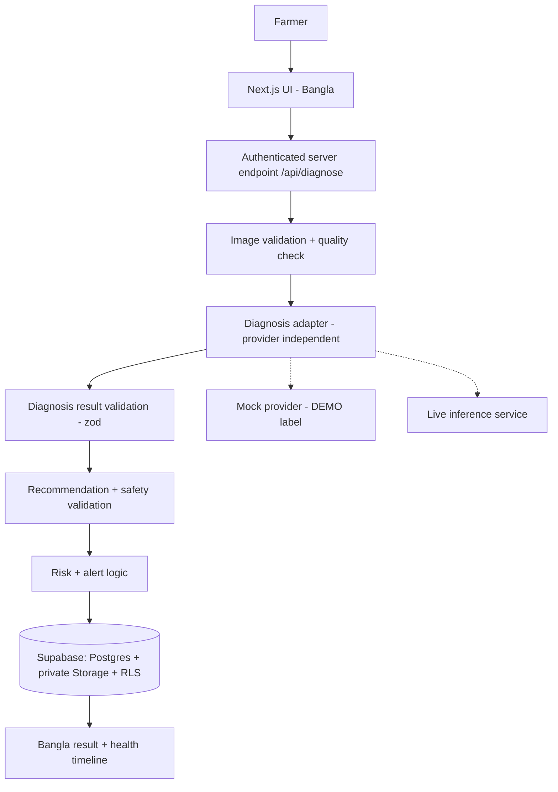

# AgriSphere — Architecture

> Status legend: **[exists]** in repo and verified · **[planned]** designed, not built. As of this commit only the scaffold and `src/contracts` exist.

## Components
| Component | Owner | Status |
|---|---|---|
| Next.js + TS + Tailwind scaffold, CI | Snikdho | [exists] |
| Shared contracts (zod) + validation helpers | Snikdho | [exists] |
| UI / Bangla / voice | Sejda | [planned] |
| Supabase auth, DB, storage, RLS | Rajva | [planned] |
| Diagnosis provider + image quality | Joy | [planned] |
| Recommendations, safety, risk, alerts | Samia | [planned] |
| `/api/diagnose` orchestration | Snikdho | [planned] |

## Request flow (planned)

Only `DV` (validation helpers) exists today.

## Boundaries and rules
- **Auth:** every `/api/*` route requires a Supabase session; server resolves `user.id` itself, never trusts a client-sent user id.
- **Images:** private bucket, path prefixed by user id; ownership checked on every read. No public URLs.
- **AI output is untrusted:** `validateProviderOutput` → `invalid_response` on any schema failure.
- **Statuses:** `ok | low_confidence | unknown_disease | poor_image | provider_unavailable | invalid_response`. Non-`ok` results must not show confident advice.
- **Confidence vs severity:** separate fields; status derivation uses confidence + quality + disease only.
- **Mock data:** `source: "mock_demo"` must be visibly labelled in the UI and never stored as `live`.
- **Deployment:** Vercel (Next.js) + Supabase. The CV model likely runs as a separate inference service (decision pending with Joy).
- **External dependencies:** Supabase, Vercel, inference service (TBD), optional weather API.
